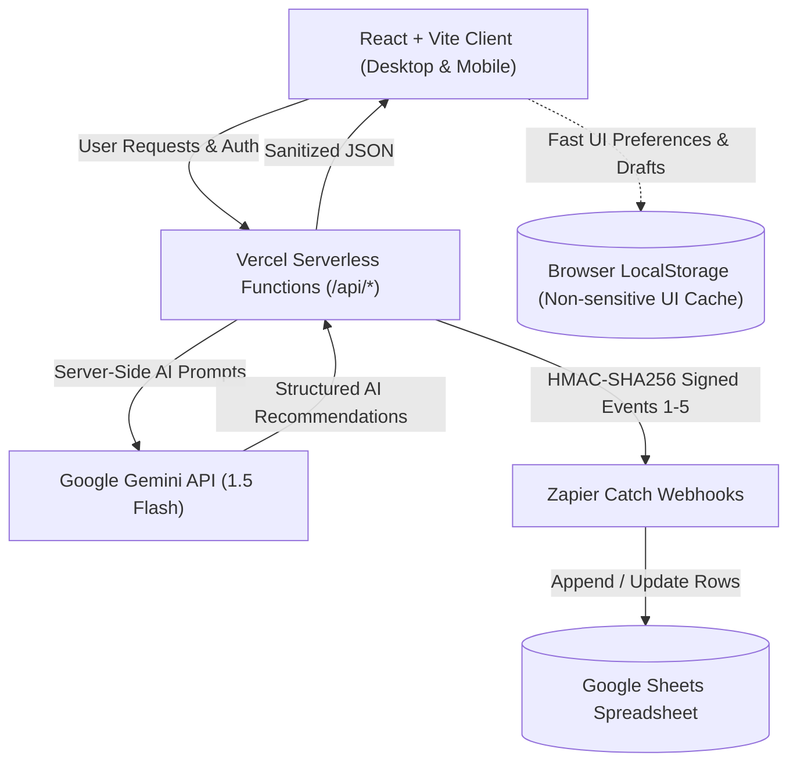

# CAREERPILOT AI
> **Discover Your Potential. Design Your Future.**  
> *Your Career. Your Potential. Your AI Mentor.*

CareerPilot AI is a production-grade, responsive AI SaaS platform engineered for students, aspiring engineers, and tech career changers. It combines **Google Gemini API** dynamic intelligence with a lightweight, cost-effective serverless backend architecture utilizing **Google Sheets** (via **Zapier Webhooks**) as the persistent data tier — eliminating traditional paid database overhead (no Supabase, Firebase, MongoDB, or PostgreSQL).

---

## 🌟 Key Features

### 1. 🧭 Dynamic AI Career Assessment Engine
- Powered by **Google Gemini API** (`gemini-1.5-flash`).
- Dynamically analyzes student degree, academic year, interests, verified competencies, and weekly availability.
- Synthesizes **5 deeply personalized career paths** with match percentages, compensation ranges, key technical/soft skill prerequisites, capstone project ideas, and industry growth outlooks.
- Includes a **Side-by-Side Career Comparison** matrix.

### 2. 🗺️ Personalized Learning Roadmaps
- Milestone-driven curricula for roles such as *AI & Machine Learning Engineer*, *Full-Stack Cloud Architect*, *Data Systems Engineer*, and *DevOps Platform Engineer*.
- Complete stage breakdown with practical coding tasks, curated documentation links, and project deliverables.
- Interactive milestone check-off that computes **true progress percentage** based strictly on actual completed tasks (no arbitrary progress percentages).
- Support for custom milestone creation and dynamic curriculum regeneration.

### 3. 🤖 Context-Aware AI Mentor
- Real-time chat powered server-side by Google Gemini API.
- Calibrated to the student's active target role, verified skills, and academic profile.
- Suggested prompt pills for high-yield questions (*"What should I learn next?"*, *"How do I prepare for technical interviews?"*, *"Which projects make my resume stand out?"*).
- Student consent toggle to save session summaries to Google Sheets.
- **Security Guarantee:** Gemini API keys are kept strictly server-side and never leaked to the client browser.

### 4. 🧬 Career Digital Twin
- Continuously evolving digital simulation of the student's industry readiness.
- Interactive circular readiness gauge calculated strictly from completed roadmap milestones.
- Matrix of verified competencies vs required industry skill gaps.
- One-click JSON export of the student's verified digital twin profile.

### 5. 🎯 Skill Gap Analysis
- Visual comparison contrasting current student abilities against target role requirements.
- Categorized into *Existing Competencies*, *Needs Improvement*, and *Missing Gaps*.
- Priority weighting (High, Medium, Bonus) with links to official documentation.

### 6. 💼 Internship Discovery Hub
- Search and filter opportunities by domain, location, and remote vs on-site.
- Verified demo opportunities with authentic compensation rates, duration, and eligibility criteria.
- Bookmark roles to trigger **EVENT 5 (Internship Saved)**, syncing directly to Google Sheets with application status tracking (*Saved*, *Applied*, *Interviewing*, *Offer Received*).

### 7. 📄 ATS-Optimized Resume Builder & PDF Export
- Live side-by-side editor with real-time A4 document preview.
- AI-generated professional summary tailored to target role and experience.
- One-click client-side PDF generation using `jspdf` and `html2canvas`.

### 8. 🎙️ AI Interview Coach & Mock Studio
- Real-time technical, system design, and behavioral STAR questions.
- Instant AI evaluation returning numerical scores (0–100), key strengths, areas to elevate, and an ideal senior-level formulation.

---

## 📊 Architecture & Data Flow



### Data Storage Architecture
1. **Google Sheets (via Zapier Webhooks):** Serves as the persistent audit and records repository. Every significant student milestone, registration, assessment, and bookmarked opportunity is routed server-side to Zapier to append to respective spreadsheet tabs.
2. **Local Storage:** Used exclusively for temporary UI preferences, draft form state, and non-sensitive cache.
3. **Zero Plaintext Credentials:** Passwords in prototype mode are cryptographically salted and hashed using PBKDF2 with SHA-512. No passwords or secret keys are ever forwarded to Google Sheets or stored in browser storage.

---

## ⚡ Automation Events & Google Sheets Schema

Configure your Google Sheet with the following **8 dedicated tabs**:

| Tab Name | Automation Event Triggered | Fields Appended |
| :--- | :--- | :--- |
| **`Students`** | **EVENT 1:** Student Registration | Student ID, Full Name, Email, Registration Date, Account Type |
| **`Career Assessments`** | **EVENT 2:** Career Assessment Completed | Student ID, Name, Email, Education, Domain, Top Match, Assessment Date |
| **`Career Recommendations`** | **EVENT 2:** Career Assessment (Paths) | Student ID, Path Title, Category, Match %, Salary Range, Key Skills |
| **`Roadmaps`** | **EVENT 3:** Roadmap Generated | Student ID, Roadmap Title, Target Career, Total Milestones, Generated Date |
| **`Milestone Progress`** | **EVENT 4:** Milestone Completed | Student ID, Email, Milestone ID, Milestone Title, Completion Date, Progress % |
| **`Saved Internships`** | **EVENT 5:** Internship Saved | Student ID, Email, Job Title, Company, Location, Type, Saved Date |
| **`Resume Records`** | Resume Exported | Student ID, Email, Target Role, Technical Skills, Last Exported |
| **`Integration Logs`** | System Webhook Ping / Handshake | Event ID, Event Type, Timestamp, Status, Latency MS |

---

## 🚀 Getting Started

### Prerequisites
- **Node.js** >= 18.0.0
- **npm** >= 9.0.0
- Google Gemini API Key (free from [Google AI Studio](https://aistudio.google.com/))
- *(Optional for live sync)* Zapier Webhook URL

### 1. Clone & Install
```bash
git clone https://github.com/your-username/careerpilot-ai.git
cd careerpilot-ai
npm install
```

### 2. Environment Variables Configuration
Copy the template file:
```bash
cp .env.example .env
```
Fill in your credentials:
```env
# Google Gemini AI API Key
GEMINI_API_KEY=AIzaSy...

# Zapier Webhook Catch URL for Google Sheets automation
ZAPIER_WEBHOOK_URL=https://hooks.zapier.com/hooks/catch/...

# Shared secret key for HMAC event signing
ZAPIER_WEBHOOK_SECRET=cp_live_secret_77189
```

> **Note:** If `GEMINI_API_KEY` is not provided, CareerPilot AI gracefully activates its high-yield offline heuristic mentor engine so you can test all features and UI workflows immediately.

### 3. Run Locally
```bash
npm run dev
```
Open [http://localhost:5173](http://localhost:5173) in your browser. Vite's built-in dev API middleware executes the serverless functions locally without requiring external tools.

### 4. Build for Production
```bash
npm run build
```

---

## 🌐 Vercel Deployment Guide

CareerPilot AI is built natively for zero-configuration deployment on **Vercel**:

1. Push your repository to **GitHub**:
   ```bash
   git add .
   git commit -m "feat: complete CareerPilot AI platform"
   git push origin main
   ```
2. Navigate to [Vercel Dashboard](https://vercel.com/) and click **"Add New Project"**.
3. Import your GitHub repository.
4. In the **Environment Variables** section, configure:
   - `GEMINI_API_KEY`
   - `ZAPIER_WEBHOOK_URL`
   - `ZAPIER_WEBHOOK_SECRET`
5. Click **"Deploy"**.
6. Vercel automatically deploys both the frontend static SPA assets and the `/api/*` serverless functions onto the same domain!

---

## 🛡️ Security & Privacy Notice
- **No Plaintext Passwords:** Client passwords are submitted only over TLS to the serverless auth endpoint and salted using PBKDF2.
- **API Key Isolation:** `GEMINI_API_KEY` and `ZAPIER_WEBHOOK_SECRET` are strictly loaded in Node.js serverless functions and never exposed to client bundles.
- **User Consent:** Students can toggle Google Sheets logging on or off at any time in the **Integrations & Sync** tab.

---

## 📄 License
MIT License. Built for educational excellence and student career empowerment.
